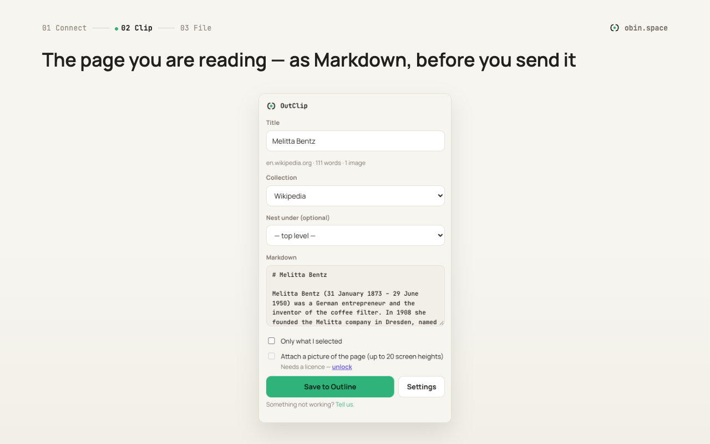
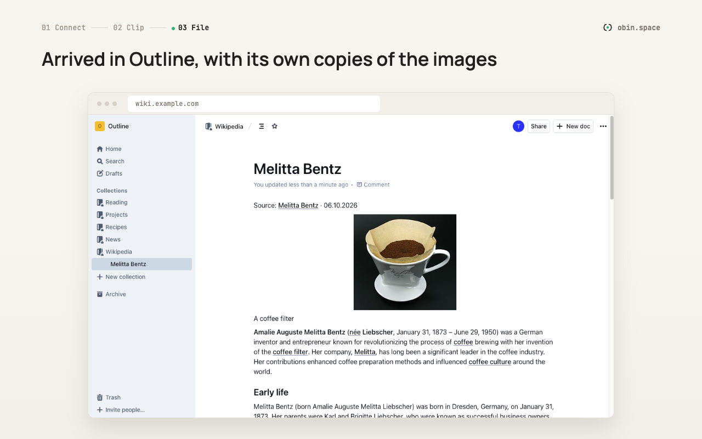

# OutClip for Outline

Save the page you are reading into your own self-hosted [Outline](https://www.getoutline.com) — as clean Markdown, with the full text and images.

**[Get it on the Chrome Web Store](https://chromewebstore.google.com/detail/picjbegjckaabibddfilpolfhcekmjae)** · **[Get it for Firefox](https://addons.mozilla.org/addon/outclip-for-outline/)** · [obin.space/outclip](https://obin.space/outclip)

> **About this repository:** The source code of OutClip is not public. This repository is for documentation, release notes and bug reports.

## What it does

- **Full text, not fragments.** Article extraction with Defuddle, the library behind the Obsidian Web Clipper. Navigation, ads and comments are left behind.
- **Pick where it lands.** Choose the collection and parent document from your real Outline tree, or create a new collection.
- **Images become yours.** Your Outline server imports each image itself and keeps its own copy. Anything it cannot reach stays as a link.
- **Append to an existing document** instead of creating a new one.
- **Edit before you save.** Fix the title, trim the Markdown, then send it.
- **Nothing is lost.** Close the popup by accident and your work is still there.
- **Keyboard:** Ctrl/Cmd + Shift + O opens OutClip, Ctrl/Cmd + Enter saves.
- German and English, following your browser's language.

## Where your data goes

To the Outline address you entered yourself. Nowhere else. No vendor server, no analytics, no telemetry. OutClip asks for access to your Outline address only, not to the web at large, and it asks when you connect, not when you install.

## Price

The clipper is free, with no limits on clipping. A one-time licence (**7.99 €**, no subscription, updates included) adds:

- a full-page screenshot attached to the document
- recipe documents (ingredients as a checklist, numbered steps)
- multiple Outline servers
- rules per site

Buy it at [obin.space/outclip](https://obin.space/outclip).

## Requirements

Your own Outline instance and a personal API token (Outline → Settings → API Keys). Tested with self-hosted Outline 1.7.1 and 1.10.1.

## Guide

Step by step (German): [obin.space/outclip/anleitung](https://obin.space/outclip/anleitung)

## Report a bug

[Open an issue](../../issues/new/choose). Please include the page address, your browser and Outline version, and what you expected to happen.

---

Made by one person in Bavaria, built with the help of AI tools and tested on 100 real pages before release. More at [obin.space](https://obin.space).
